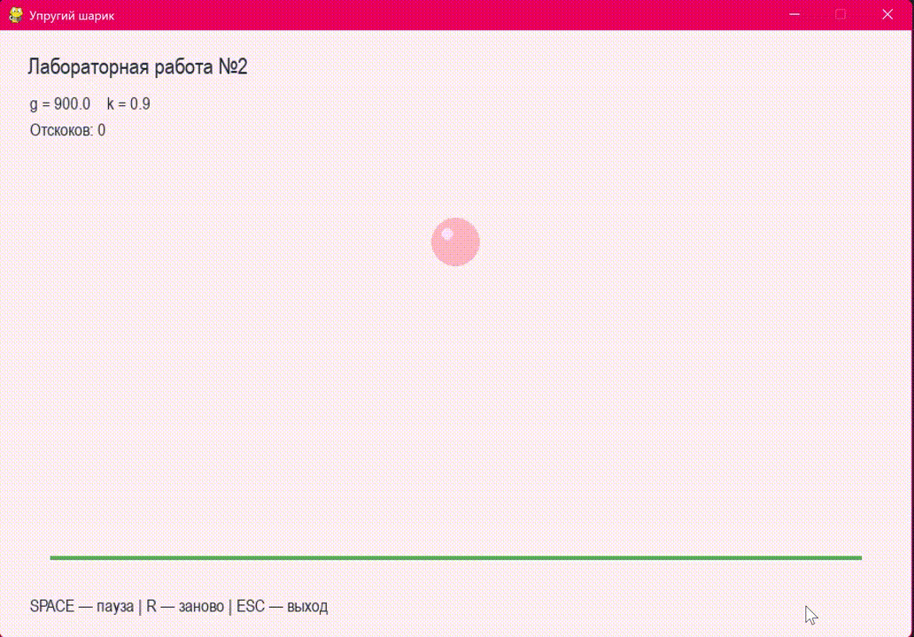

# Лабораторная работа по дисциплине "Компьютерная графика" №2: Вывод движущихся изображений

## Описание программы
Программа моделирует движение шарика. При столкновении с горизонтальной плоскостью шарик отскакивает, а его скорость уменьшается в соответствии с коэффициентом отражения.
Анимация завершается, когда высота очередного отскока становится меньше заданного значения.

## Демонстрация работы


## Программа реализована на языке:

| Язык | Интерпретатор/Версия | Среда разработки |
| :--- |:---------------------|:-----------------|
| Python | Python / 3.12        | PyCharm 2024.2.4 |

## Управление
- ESC — выход из программы
- SPACE — пауза или продолжение
- R — перезапуск анимации

## Установка
Установить необходимые библиотеки:

```bash
python -m pip install -r requirements.txt
```
## Запуск
Скачайте файл `main.py` из этого репозитория.

Запустите файл:
```bash
python main.py
```

